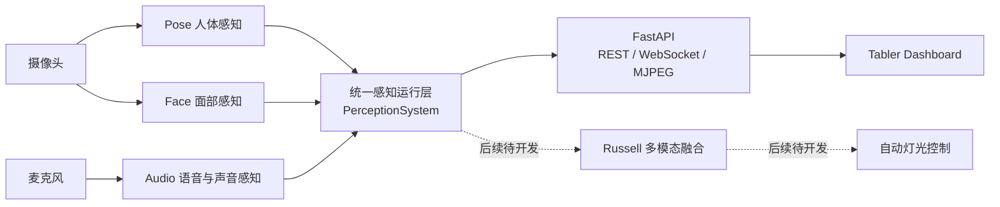

# 智慧医疗照明系统

面向精神卫生护理场景的多模态智能照明研究与工程验证原型。系统通过普通摄像头和麦克风采集客观观测，分别进行人体姿态与动作识别、人脸表情候选分析、语音转写、环境声音识别及语音韵律分析，并通过统一运行层在本地 Dashboard 中实时展示。

Russell 多模态综合评估和自动灯光控制仍处于后续开发阶段。当前输出仅表示外观、动作和声音的工程观测或候选状态，不用于独立医学诊断、疾病判断或临床决策。

## 系统架构



Pose 和 Face 共享一个摄像头，所有音频功能共享一个麦克风。模型只在服务生命周期内初始化一次，网页客户端读取共享的最新结果和 JPEG 缓存，不会因打开多个页面而重复执行推理。

## 技术选型

| 组件 | 用途 |
|---|---|
| MediaPipe Pose Landmarker Lite | 33点人体骨架检测 |
| MediaPipe Face Landmarker | 478点面部网格、52项 Blendshape 和面部变换矩阵 |
| NumPy | 姿态、活动、表情、韵律及时序规则分析 |
| Silero VAD / Sherpa-ONNX | 语音活动检测和语音片段划分 |
| SenseVoiceSmall INT8 | 非流式语音转写及模型标签输出 |
| YAMNet | 521类环境声音评分及护理相关白名单筛选 |
| OpenCV / Pillow | 摄像头处理、关键点绘制和中文可视化 |
| SoundDevice | 16 kHz Float32 单声道麦克风采集 |
| FastAPI / Uvicorn / WebSocket | 本地服务、控制接口和实时数据通信 |
| Tabler 1.7.5 / Chart.js 4.6.2 | 离线 Dashboard 和 Russell 平面绘制 |

Python 包的精确版本见 [`requirements.txt`](requirements.txt)，算法参数分别位于 `config/pose_config.py`、`config/face_config.py`、`config/audio_config.py` 和 `config/system_config.py`。

## 工程目录

```text
smart_medical_lighting/
├── config/                     # Pose、Face、Audio 及系统运行参数
├── demos/
│   ├── pose_demo.py            # 人体感知独立入口
│   ├── face_demo.py            # 面部感知独立入口
│   └── audio_demo.py           # 音频感知独立入口
├── models/                     # 本地预训练模型（默认被 Git 忽略）
│   ├── pose/
│   ├── face/
│   └── audio/
├── src/
│   ├── acquisition/            # Camera 和 Microphone 采集
│   ├── pose/                   # 人体 Detector、Analyzer、Visualizer
│   ├── face/                   # 面部 Detector、Analyzer、Visualizer
│   ├── audio/                  # 音频 Detector、Analyzer、Visualizer
│   └── system/
│       └── perception_system.py # 共享设备、调度、缓存和生命周期
├── tests/                      # unittest 数学、时序和运行层测试
├── web/
│   ├── app.py                  # FastAPI 入口
│   ├── templates/index.html    # Dashboard 页面
│   └── static/                 # 本地 CSS、JavaScript、Tabler、Chart.js
├── requirements.txt
└── README.md
```

## 环境安装与模型准备

当前开发环境为 Windows 11 和 Python 3.11。以下路径仅为通用示例，不要求安装到特定磁盘：

```powershell
git clone https://github.com/Counter-Attack-Mankind/smart-medical-lighting.git
cd smart-medical-lighting
py -3.11 -m venv .venv
.\.venv\Scripts\Activate.ps1
python -m pip install -r requirements.txt
```

需要准备以下与当前配置兼容的模型文件：

```text
models/pose/pose_landmarker_lite.task
models/face/face_landmarker.task
models/audio/silero_vad.onnx
models/audio/yamnet.tflite
models/audio/sensevoice/model.int8.onnx
models/audio/sensevoice/tokens.txt
```

模型文件体积较大且默认由 `.gitignore` 排除，请从相应模型的官方发布渠道取得，并遵守各自许可证；仓库当前没有统一模型下载脚本。实际路径以三个配置文件中的 `MODEL_PATH` 或模型目录配置为准。

Tabler 和 Chart.js 的已构建发行文件保存在 `web/static/vendor/`，Dashboard 不依赖在线 CDN。需要通过本地代理下载依赖或模型时，可临时设置：

```powershell
$env:HTTP_PROXY = "http://127.0.0.1:7890"
$env:HTTPS_PROXY = "http://127.0.0.1:7890"
```

## 快速启动

启动统一 Dashboard：

```powershell
.\.venv\Scripts\python.exe -m uvicorn web.app:app --host 127.0.0.1 --port 8000
```

浏览器访问 <http://127.0.0.1:8000>。默认仅监听本机回环地址。

独立模块仍可分别运行：

```powershell
.\.venv\Scripts\python.exe -m demos.pose_demo
.\.venv\Scripts\python.exe -m demos.face_demo
.\.venv\Scripts\python.exe -m demos.audio_demo
```

## Dashboard 功能

顶部四个状态卡片显示综合状态占位、当前仿真照度、控制模式和共享摄像头实际性能。主体保持以下七个模块：

1. 人体动作识别：骨架画面、姿态、运动、行为候选、可靠性和推理性能。
2. 人脸表情识别：面部网格、表情候选、面部活动、头姿和可靠性。
3. 多模态综合评估：Russell 平面、权重和后续融合接口；当前不生成虚构评分。
4. 语音及声音事件识别：当前语音状态、历史转写、SenseVoice 标签和 YAMNet 白名单事件。
5. 实时音频波形：同一麦克风最近最多5秒的峰值保留包络，不传输完整原始 PCM。
6. 虚拟灯光控制：手动0～600 lux仿真和模式切换；自动策略尚未接入。
7. 状态历史与调节记录：最近50条真实系统或控制事件，不保存转写内容。

仿真 lux 仅是后端设定值，不代表实际物理照度或临床照明处方。

## 测试与开发进度

运行全部测试：

```powershell
.\.venv\Scripts\python.exe -m unittest discover -s tests -v
```

测试数量会随开发变化，应以命令的实际输出为准。

| 阶段 | 状态 |
|---|---|
| Stage 01：Pose Landmarker 部署 | 已完成 |
| Stage 02：人体姿态、活动及行为分析 | 已完成主要开发 |
| Stage 03：Face Landmarker 与表情时序分析 | 已完成主要开发 |
| Stage 04：VAD、ASR、声音事件及韵律分析 | 已完成主要开发 |
| Stage 05.1：本地 Web 技术验证 | 已完成 |
| Stage 05.2–05.3：统一运行层与 Dashboard | 已完成 |
| Stage 05.3.1：稳定性与交互优化 | 已完成 |
| Stage 05.4：多模态融合 | 未完成 |
| Stage 05.5：自动灯光控制 | 未完成 |
| Stage 05.6：ARM64 嵌入式性能评估 | 未完成 |

## 隐私与使用限制

- 系统默认在本地运行并监听 `127.0.0.1`，不要在未配置访问控制时暴露到外部网络。
- 默认不保存原始音频、视频文件或敏感语音转写历史。
- 环境声音来自麦克风覆盖范围，不能直接归因于特定患者。
- MediaPipe、SenseVoice、YAMNet 及规则评分均可能受距离、遮挡、噪声、视角和设备差异影响。
- 所有输出属于客观观测特征或候选状态，不代表真实内部情绪、精神疾病诊断或攻击风险判断。
- 使用者应遵守隐私、知情同意、数据保护及医疗设备相关法规。
